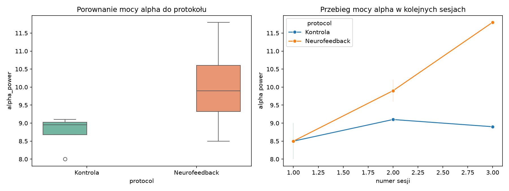

# Neuro ETL Pipeline

Data cleaning, relational merging, and feature engineering pipeline for EEG study records built with Python, Pandas, and NumPy.

## Features
- Cleaning participant metadata (string formatting, missing value imputation, memory-efficient type casting)
- Merging participant records with EEG session logs
- Datetime parsing and temporal feature extraction (`day_name`, `is_weekend`)

## Tech Stack
- Python 3.x
- Pandas
- NumPy
- Matplotlib
- Seaborn

## How to Run
```bash
pip install -r requirements.txt
python neuro_etl_pipeline.py
```
## Wizualizacja wyników



**Wniosek:** Uczestnicy poddani protokołowi Neurofeedback osiągnęli wyraźnie wyższą medianę mocy fal Alfa oraz systematyczny wzrost wyników w kolejnych sesjach w porównaniu do grupy kontrolnej.